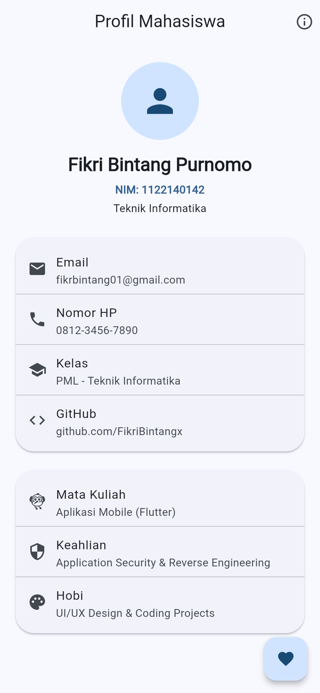
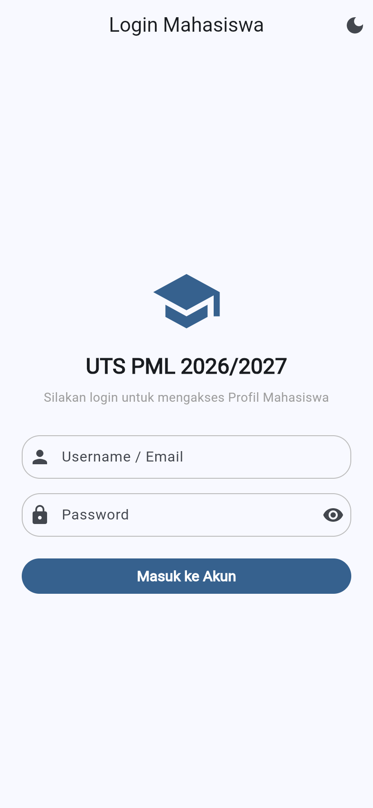
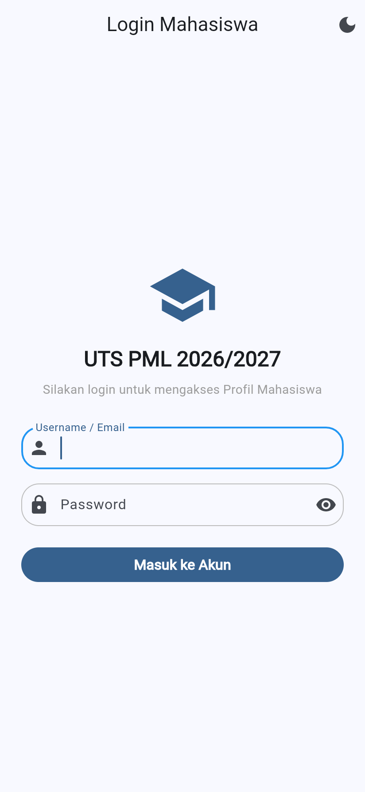
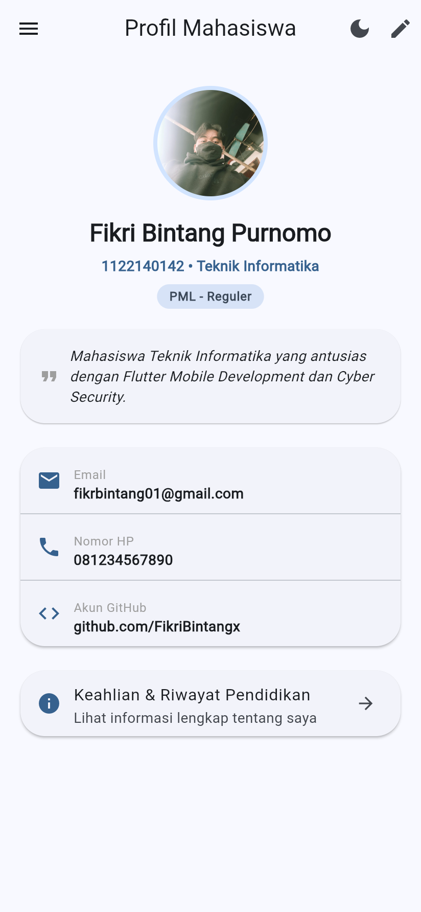
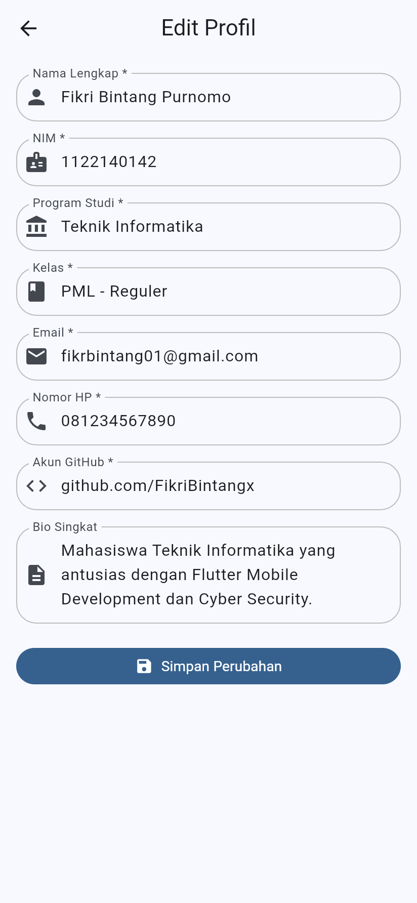
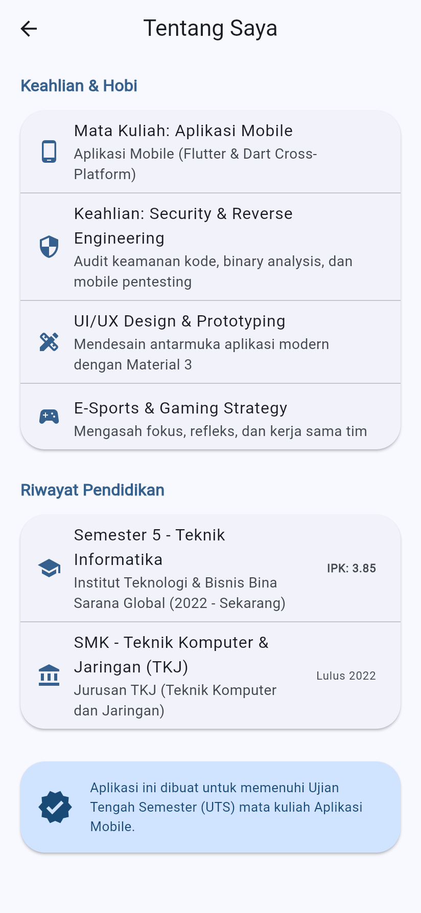

# UTS Aplikasi Mobile
**Institut Teknologi & Bisnis Bina Sarana Global**

---

### Informasi Mahasiswa

| Atribut | Keterangan |
| :--- | :--- |
| **Nama** | Fikri Bintang Purnomo |
| **NIM** | 1122140142 |
| **Kelas** | Pemrograman Aplikasi Mobile |
| **Program Studi** | Teknik Informatika |

---

### Link Video Demo & Release APK

<p align="center">
  <a href="https://youtu.be/rcAyvJ13tH0" target="_blank">
    
  </a>
  &nbsp;
  <a href="https://github.com/FikriBintangx/uts-pml-1122140142/releases/tag/v1.0.0" target="_blank">
    
  </a>
</p>

> 🔗 **Direct URL YouTube:** [https://youtu.be/rcAyvJ13tH0](https://youtu.be/rcAyvJ13tH0)

---

### Struktur Project

* `soal1-live-coding/`
* `soal2-profil-app/`

---

### Dokumentasi & Screenshot Aplikasi

#### 1. Halaman Profil StatelessWidget (Soal 1)
<p align="center">
  
</p>

---

#### 2. Halaman Login Mahasiswa (Soal 2)
<p align="center">
  
</p>

---

#### 3. Halaman Validasi & Error Login
<p align="center">
  
</p>

---

#### 4. Halaman Profil Utama (Light Mode)
<p align="center">
  
</p>

---

#### 5. Halaman Profil (Dark Mode)
<p align="center">
  
</p>

---

#### 6. Halaman Navigasi Drawer
<p align="center">
  
</p>

---

#### 7. Halaman Edit Profil
<p align="center">
  
</p>

---

#### 8. Halaman Tentang Saya (About Page)
<p align="center">
  
</p>

---

### Cara Menjalankan

#### Menjalankan Soal 1
```bash
cd soal1-live-coding
flutter pub get
flutter run
```

#### Menjalankan Soal 2
```bash
cd soal2-profil-app
flutter pub get
flutter run
```

#### Build APK Release (Soal 2)
```bash
cd soal2-profil-app
flutter build apk --release
```
> File APK release otomatis tersimpan di: `build/app/outputs/flutter-apk/app-release.apk`
